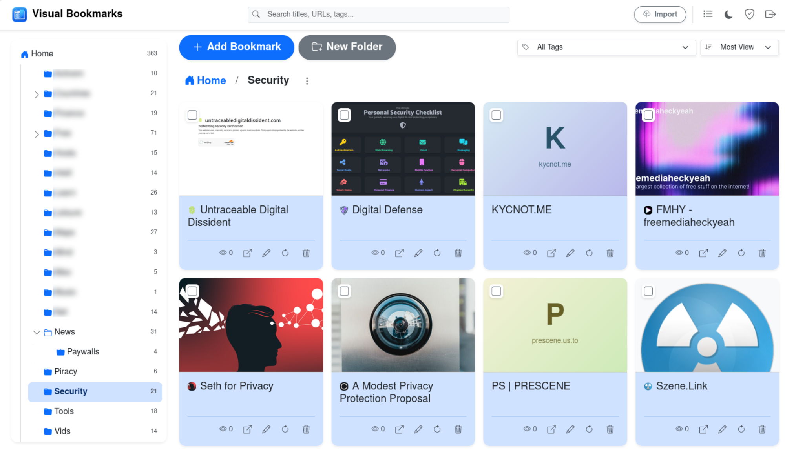

# Visual Bookmarks Pro

Visual Bookmarks Pro is a secure, self-hosted PHP/SQLite web application that transforms your saved web links into a visual, desktop-like workspace. It automatically captures webpage screenshots and titles, creating a beautiful and organized personal knowledge base.

## ✨ Features

* **Automated Visuals:** Automatically scrapes webpage titles and site icons and stores a preview image locally for every link: the YouTube thumbnail, else the page's og:image, else a Thum.io screenshot. Links without a preview show the site icon.
* **Desktop-like Experience:** Drag and drop bookmark cards directly into folders, and double-click cards to instantly visit the links.
* **Advanced Organization:** Nested folders in a collapsible tree that stays in view while scrolling and can be resized, a breadcrumb path, folder cards showing a 2×2 mosaic of the links inside, and a comma-separated multi-tag system for granular filtering.
* **Privacy:** No referrer is sent, Bootstrap is served locally, icons and previews are fetched by the server, and a Content-Security-Policy keeps the page to its own origin. Server-side fetches only reach public addresses.
* **Bulk Management:** Select multiple bookmarks to delete, move to new folders, or apply new tags all at once using the floating action bar.
* **Master Password Security:** The entire application and its API are locked behind a session-based master password to keep your data private.
* **Admin Batch Scanner:** A built-in dashboard tests the uptime of all saved links, force-refreshes missing screenshots, and allows you to bulk-delete dead websites with one click.
* **Browser Integration:** Includes a simple drag-and-drop bookmarklet with a per-installation token for your browser's bookmarks bar, allowing you to save any site in one click without leaving the page.
* **HTML Import:** Easily migrate from Chrome, Safari, Firefox, or Edge by importing your standard HTML bookmarks file; its folder structure is kept.
* **Modern UI:** Responsive grid and compact list views, built-in dark mode toggle, and smooth loading states using Bootstrap 5.

## 🛠️ Prerequisites

To run Visual Bookmarks Pro, your web server must support the following:
* **PHP:** Version 8.2 or newer (the address check uses `FILTER_FLAG_GLOBAL_RANGE`)
* **SQLite3 Extension:** Enabled (Standard in most PHP installations)
* **cURL Extension:** Enabled (Required for fetching titles, previews and icons, and for the Admin Scanner uptime checks)
* **File Permissions:** The server must have read/write permissions for the application's root directory to generate the `database.sqlite` file and the `/screenshots/` and `/icons/` folders.

## 🚀 Installation & Setup

1. **Download/Clone** the repository to your web server (e.g., Apache, Nginx) or local environment (e.g., XAMPP, MAMP, Laravel Valet).
2. **Set the Master Password:**
   * Open `functions.php` in a text editor.
   * Locate the `$MASTER_PASSWORD = 'admin';` variable at the top of the file.
   * Change `'admin'` to a secure password of your choice.
3. **Run the App:** Navigate to the folder in your web browser (e.g., `http://localhost/visual-bookmarks/`).
4. **Auto-Setup:** Upon your first login, the application will automatically create the `database.sqlite` file and the `screenshots` and `icons` directories if they do not already exist.

## 🖥️ Usage

* **Adding a Bookmark:** Click the "Add Bookmark" button, paste a URL, and assign it to a folder and tags. The server will capture the image in the background.
* **The Bookmarklet:** Open the Admin Dashboard (shield icon) and drag the "Save to Bookmarks" button to your browser's bookmarks bar. Click it on any website to save the page directly to your app.
* **Admin Scanner:** Click the shield icon in the top navigation bar to open the Admin Dashboard and verify the health of your saved links.

## 🗄️ File Structure

* `index.php` - The main frontend interface and login screen.
* `api.php` - The RESTful backend engine handling CRUD operations, scanning, and importing.
* `functions.php` - Core configuration, SQLite database connection, and scraping utilities.
* `save.php` - The secure endpoint handled by the browser bookmarklet popup.
* `app.js` - The frontend logic: folder tree, cards, drag & drop and dialogs.
* `icon.php` - Serves site icons from the server-side cache.
* `vendor/` - Bootstrap and Bootstrap Icons, served locally.
* `bookmark.png` - The application icon.

## 📝 License
This project is open-source and free to use for personal knowledge management.
